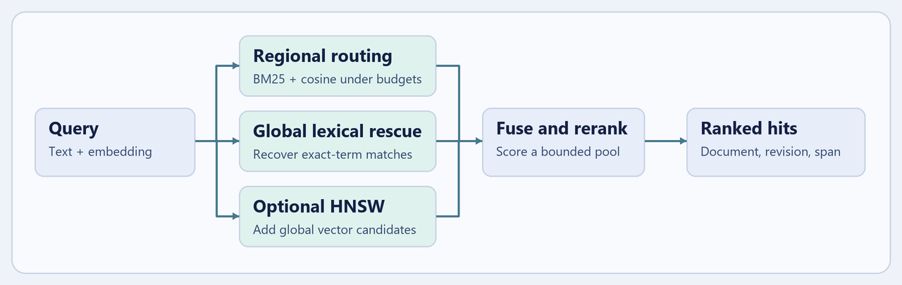

# Loci Search

[](https://github.com/AncientiCe/loci-search/actions/workflows/ci.yml)
[](https://crates.io/crates/loci-search)
[](https://docs.rs/loci-search)
[](LICENSE)
[](https://www.rust-lang.org)


Loci Search is a local Rust CLI and library for hybrid retrieval over text and precomputed embeddings. It combines BM25 and vector similarity, routes searches through semantic regions, and explains which evidence and ranking signals surfaced each hit.

[Benchmark history](benchmarks/README.md) · [Reproduce the benchmarks](benchmarks/reproduce.md) · [Changelog](CHANGELOG.md) · [MIT License](LICENSE)

## Highlights

- **One file, no server.** Passages, embeddings, and the index live in a single SQLite database. Ingest replaces the snapshot atomically.
- **Hybrid by default.** BM25 and cosine similarity are fused and reranked over a bounded candidate pool.
- **Semantic region routing.** Searches visit a budgeted set of regions instead of the whole corpus, with global lexical rescue and an optional HNSW graph to recover what routing misses.
- **Explainable hits.** Every result carries its document, revision, and source span, plus its lexical, vector, and global lexical ranks and the route that reached it.
- **Bring your own embeddings.** Loci never calls an embedding model. You supply passage and query vectors from any embedding model.
- **Built-in evaluation.** `bench` reports Recall@k, nDCG, and warm latency percentiles on judged queries or a deterministic synthetic fixture.

## Quick start

Install Rust 1.95 or newer and a C compiler to build bundled SQLite. On Windows with the MSVC Rust toolchain, install the Visual Studio C++ Build Tools.

From the repository root, generate a small synthetic corpus, ingest it, and run an explained query. The example uses no downloads beyond the Rust dependencies and needs no embedding service.

```sh
cargo run --locked --release -- fixture --chunks 128 --out runs/example-data
cargo run --locked --release -- ingest --db runs/example.sqlite --passages runs/example-data/passages.jsonl --embedding runs/example-data/embedding.json
cargo run --locked --release -- search --db runs/example.sqlite --query runs/example-data/query.json --limit 5 --explain
```

Each explained hit shows where the passage came from and why it ranked:

```json
{
  "id": "chunk-000000000",
  "document": "fixture/000000000.txt",
  "revision": "1",
  "start": 0,
  "end": 82,
  "text": "NOVA000X means an expired lease after a gateway rotation. Rotate the lease holder.",
  "score": 0.7564,
  "lexical_rank": 1,
  "vector_rank": 17,
  "global_lexical_rank": 1,
  "routes": [{ "entry_landmark": "chunk-000000087", "path": [{ "region": 0, "via": "entry" }] }]
}
```

Run `cargo run --locked -- --help` to see all commands, or follow [Use your own corpus](#use-your-own-corpus) for the input formats.

## Install

- **Prebuilt binaries:** Windows and Linux x86-64 archives with SHA-256 checksums are attached to each [GitHub release](https://github.com/AncientiCe/loci-search/releases).
- **From crates.io:** `cargo install loci-search --locked`
- **From this checkout:** `cargo install --path . --locked --bin loci`

The installed binary is named `loci`.

## Commands

| Command | Purpose |
| --- | --- |
| `fixture` | Generate deterministic passages, embeddings, and relevance judgments |
| `ingest` | Atomically replace the index with a complete JSONL snapshot |
| `search` | Search with a query JSON file containing a precomputed embedding |
| `bench` | Compare global and regional retrieval on judged queries or a generated fixture |
| `graph-build` | Build and save the global HNSW graph next to an index |
| `profile` | Profile regional query phases with the settings from a prior comparison |
| `rescue-dev`, `recall-dev` | Tune and audit retrieval on development queries only |

## How regional search works



Each passage and embedding is stored once in SQLite. A passage can belong to up to three semantic regions. Routing follows the region hierarchy and shared-membership edges, with configurable limits on the regions, passages, and postings it visits. Global lexical rescue and an optional HNSW graph contribute candidates beyond the regions visited. Explained hits show source provenance and the ranking signals used.

## Benchmark results


In the recorded held-out HotpotQA run on one million passages, Loci regional search reached **89.38% Recall@100** at **31.01 ms warm p95**. Tuned Elasticsearch in the same run reached **90.00%** at **41.20 ms warm p95**. The paired recall difference was −0.63 percentage points with a 95% interval of −2.03 to +0.78. On FiQA and NFCorpus, settings were selected on development queries and frozen before scoring the official test queries.

These are historical single-machine, sequential results, and the three corpora were measured with different engine versions. Earlier configurations on the same corpora had different recall and latency trade-offs. [Methods, settings, and full history](benchmarks/README.md)

The [reproduction guide](benchmarks/reproduce.md) covers the deterministic synthetic fixture and the FiQA, NFCorpus, and HotpotQA comparisons. Download external data and embeddings separately under their upstream terms.

## Use your own corpus

Use the files generated in the quick start as format examples. Each passage line has a stable `id`, `document`, `revision`, `start`, `end`, `text`, and numeric `vector`. The caller supplies the source offsets and may include an optional `metadata` object. An embedding manifest has `model_revision`, `dimensions`, and `normalization` set to `"l2"`. A query has `id`, `text`, `embedding` (the complete manifest), and `vector`. Evaluation also accepts `group`, a `judgments` object mapping chunk IDs to integer relevance grades, and `required` chunk IDs for all-evidence recall. Grade zero denotes nonrelevant.

Ingest replaces the complete index snapshot atomically. Use unique chunk IDs and the same embedding model revision for passages and queries. The engine normalizes finite nonzero vectors at both boundaries.

To benchmark judged queries, pass a JSONL file of queries to `bench`. This example uses the files from the quick start.

```sh
cargo run --locked --release -- bench --db runs/example.sqlite --queries runs/example-data/queries.jsonl --out runs/example-bench
```

## Status and limitations

Loci is a single-node research preview, and its formats and APIs may change before 1.0.

- Ingestion replaces the full index snapshot. There are no incremental updates yet.
- Both passage and query embeddings come from the caller.
- Benchmarks measure warm, sequential queries on one machine. Concurrent throughput is not yet measured.

## Contributing

Issues and pull requests are welcome. See the [contributing guide](CONTRIBUTING.md) for the checks to run, and the [security policy](SECURITY.md) for reporting vulnerabilities privately. Maintainers can follow the [release instructions](docs/releasing.md).

## License

[MIT](LICENSE)
