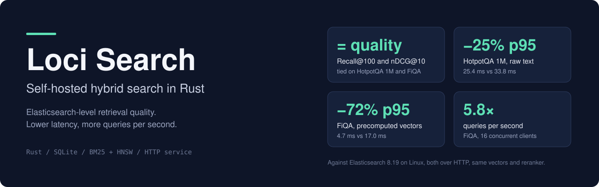

# Loci Search

[](https://github.com/AncientiCe/loci-search/actions/workflows/ci.yml)
[](https://crates.io/crates/loci-search)
[](https://docs.rs/loci-search)
[](LICENSE)
[](https://www.rust-lang.org)




Loci Search is a self-hosted search engine and Rust library. It keeps documents in SQLite, searches them with a keyword index and a vector graph, and returns each hit with its document, revision, and source span. On two public retrieval benchmarks it finds the same results as Elasticsearch and answers faster.

[Benchmark results](benchmarks/benchmark.md) · [Benchmark history](benchmarks/benchmark_history.md) · [Running the service](docs/server.md) · [Changelog](CHANGELOG.md) · [MIT License](LICENSE)

## Same quality as Elasticsearch, faster

Both engines ran on the same Linux machine, answered over HTTP, used identical vectors and the same reranker, and were measured on held-out queries after their settings were frozen on development queries.


| Corpus | Recall@100, Loci / Elasticsearch | nDCG@10, Loci / Elasticsearch | p95 latency, Loci / Elasticsearch | Queries per second at 16 clients |
| --- | --- | --- | --- | --- |
| HotpotQA, 1M passages, raw text | 90.78% / 90.63% | 0.822 / 0.823 | 25.4 / 33.8 ms | 377 / 260 |
| FiQA, 57,638 passages, precomputed vectors | 74.00% / 74.21% | 0.425 / 0.426 | 4.2 / 15.1 ms | 2,577 / 473 |

No quality difference is statistically significant. The [benchmark results](benchmarks/benchmark.md) list the setup, paired confidence intervals, every concurrency level, and the commands to reproduce them.

## How a search runs


Hybrid search, the default for text search in `loci serve`, builds two global candidate lists and merges them:

1. **Keyword search.** BM25 over in-memory postings, pruned with MaxScore, returns the best 60 passages.
2. **Vector search.** An HNSW graph saved beside the index returns the 150 nearest passages.
3. **Fusion.** Reciprocal rank fusion keeps 200 candidates and reserves slots for keyword hits.
4. **Reranking.** Each candidate is scored 92% on cosine similarity and 8% on the IDF-weighted share of query terms it contains.

The settings were chosen on HotpotQA and FiQA development queries by a rule fixed before measuring: the fastest p95 within 0.2 points of the best Recall@100. The whole path runs in one process with no external services, which is where the latency and throughput lead comes from.

## How we got here

Loci started as an experiment in the method of loci, the memory-palace technique: give every passage several addresses in a map of semantic regions, then search only the regions near a query. The benchmarks were run in the open, and the [history](benchmarks/benchmark_history.md) keeps every result, including the ones that did not favour Loci.

- **Regional search matched Elasticsearch but did not beat it.** On HotpotQA 1M with raw text, Loci tied Elasticsearch on quality, and Elasticsearch had the lower p95, 34.3 ms against 37.5 ms.
- **The quality lead came from the reranker.** Earlier gains over Elasticsearch disappeared once Elasticsearch's candidates used the same cosine-heavy reranker. Any engine can use it.
- **The regions could not rule anything out.** An exact branch-and-bound over the regions skipped no passage at all, because each region spans about 52° around its centre in 384 dimensions. Even scoring regions by their centre alone still scored 29% of the corpus.
- **Filters gave no edge.** At equal quality, filtered Elasticsearch was as fast or faster, and below 1% of the corpus a plain scan of the allowed passages won.
- **Removing the regional scan made Loci faster.** The keyword search and the vector graph found everything the regions found. Without the regional scan, Loci kept its quality, halved its startup time, nearly halved its memory, and pulled ahead of Elasticsearch.

That configuration became hybrid search in 0.4.0. Regional search is still available with `"mode": "regional"` and `--strategy regional`.

## Highlights

- **One SQLite catalog.** Documents, revisions, embeddings, and the retrieval index live in SQLite. Writes commit as one generation, and readers keep the generation they opened.
- **Hybrid search by default.** BM25 and an HNSW graph, fused and reranked, with no external search or vector service.
- **Explainable hits.** Every result carries its document, revision, and source span, its keyword, vector, and graph ranks, and its score.
- **Local or caller-supplied embeddings.** `loci serve` embeds with a pinned local model pack (`bge-small-en-v1.5` or `multilingual-e5-small`). The CLI and library accept vectors from any model.
- **Filters, facets, and permissions.** Exact search supports filters, sorting, facets, aggregations, and per-reader visibility. Semantic search sees only the documents its reader may read.
- **Built-in evaluation.** `loci bench` reports Recall@k, nDCG, latency percentiles, and throughput, and compares against Elasticsearch on the same data.

## Quick start

Install Rust 1.95 or newer and a C compiler to build bundled SQLite. On Windows with the MSVC Rust toolchain, install the Visual Studio C++ Build Tools.

### Search a synthetic corpus from the CLI

From the repository root, generate a small corpus, ingest it, and run an explained query. This needs no downloads beyond the Rust dependencies and no embedding service.

```sh
cargo run --locked --release -- fixture --chunks 128 --out runs/example-data
cargo run --locked --release -- ingest --db runs/example.sqlite --passages runs/example-data/passages.jsonl --embedding runs/example-data/embedding.json
cargo run --locked --release -- search --db runs/example.sqlite --query runs/example-data/query.json --limit 5 --explain
```

Each explained hit shows where the passage came from and why it ranked:

```json
{
  "id": "chunk-000000000",
  "document": "fixture/000000000.txt",
  "revision": "1",
  "start": 0,
  "end": 82,
  "text": "NOVA000X means an expired lease after a gateway rotation. Rotate the lease holder.",
  "score": 0.7564,
  "lexical_rank": 1,
  "vector_rank": 17,
  "global_lexical_rank": 1,
  "routes": [{ "entry_landmark": "chunk-000000087", "path": [{ "region": 0, "via": "entry" }] }]
}
```

The CLI searches with regional search by default. Add `--strategy hybrid` to run the same search as `loci serve`; it builds the HNSW graph next to the index on first use.

### Run the search service

```sh
loci model-install bge-small-en-v1.5 --data loci-data
loci serve --data loci-data
```

In another terminal, create an index, add documents, and search them:

```sh
curl -X PUT localhost:7707/v1/indexes/manuals -H 'Content-Type: application/json' -d '{"model":"bge-small-en-v1.5"}'
curl -X POST localhost:7707/v1/indexes/manuals/bulk -H 'Content-Type: application/json' \
  -d '{"operations":[{"op":"upsert","document":{"id":"vault","revision":"1","text":"The encrypted vault rotates its master key every ninety days.","fields":{}}}]}'
curl -X POST localhost:7707/v1/indexes/manuals/search -H 'Content-Type: application/json' -d '{"text":"how often is the vault key rotated","limit":3}'
```

[Running the service](docs/server.md) covers search modes, credentials, imports, backups, and model upgrades. The API is described in [openapi.json](docs/openapi.json), and Python and TypeScript clients are in [clients](clients/).

## Install

- **Prebuilt binaries:** Windows and Linux x86-64 archives with SHA-256 checksums are attached to each [GitHub release](https://github.com/AncientiCe/loci-search/releases).
- **From crates.io:** `cargo install loci-search --locked`
- **From this checkout:** `cargo install --path . --locked --bin loci`

The installed binary is named `loci`.

## Commands

| Command | Purpose |
| --- | --- |
| `serve` | Run the HTTP search service over a data directory |
| `model-install` | Install a verified local embedding model pack |
| `import` | Send Markdown, text, or JSONL records to a running server |
| `backup`, `restore` | Copy the document catalog and restore it into a fresh directory |
| `fixture` | Generate deterministic passages, embeddings, and relevance judgments |
| `ingest` | Replace a retrieval index atomically with a JSONL snapshot |
| `embed` | Encode passages and queries with an installed local model |
| `search` | Search an index with a query file, regional or hybrid |
| `graph-build` | Build and save the HNSW graph next to an index |
| `bench` | Compare strategies, and optionally Elasticsearch, on judged queries |
| `bench-serve` | Serve a frozen benchmark plan over HTTP for server-to-server comparisons |
| `pruning-dev`, `filter-dev`, `rescue-dev`, `recall-dev`, `profile` | Experiment and tuning tools that run on development queries only |

## Use your own corpus

Use the files generated in the quick start as format examples. Each passage line has a stable `id`, `document`, `revision`, `start`, `end`, `text`, and numeric `vector`. The caller supplies the source offsets and may include an optional `metadata` object. An embedding manifest has `model_revision`, `dimensions`, and `normalization` set to `"l2"`. A query has `id`, `text`, `embedding` (the complete manifest), and `vector`. Evaluation also accepts `group`, a `judgments` object mapping chunk IDs to integer relevance grades, and `required` chunk IDs for all-evidence recall. Grade zero denotes nonrelevant.

Ingest replaces the complete index snapshot atomically. Use unique chunk IDs and the same embedding model revision for passages and queries. The engine normalizes finite nonzero vectors at both boundaries.

To benchmark judged queries, pass a JSONL file of queries to `bench`. This example uses the files from the quick start.

```sh
cargo run --locked --release -- bench --db runs/example.sqlite --queries runs/example-data/queries.jsonl --out runs/example-bench
```

## Status and limitations

Loci is a single-node research preview, and its formats and APIs may change before 1.0.

- The comparison with Elasticsearch covers two corpora on one machine. It measures retrieval only, not indexing speed or features that Loci does not have.
- Hybrid search weights cosine similarity at 92%. An exact identifier that the embedding model does not represent well can rank below passages that are semantically close. Exact search (`"mode": "exact"`) and regional search weigh keyword matches more heavily.
- There is no replication or sharding. One process serves one data directory.
- The CLI `ingest` command replaces a whole retrieval snapshot. The HTTP service applies incremental writes.

## Contributing

Issues and pull requests are welcome. See the [contributing guide](CONTRIBUTING.md) for the checks to run, and the [security policy](SECURITY.md) for reporting vulnerabilities privately. Maintainers can follow the [release instructions](docs/releasing.md).

## License

[MIT](LICENSE)
