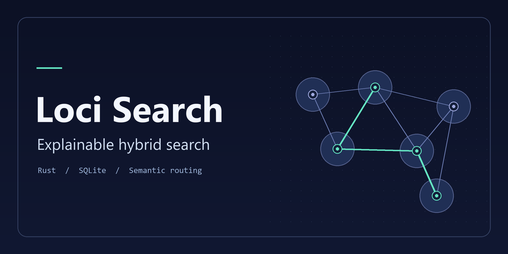

# Loci Search



Loci Search is a local Rust CLI and library for hybrid retrieval over text and precomputed embeddings. It combines BM25 and vector similarity, routes searches through semantic regions, and explains which evidence and ranking signals surfaced each hit.

[Benchmark history](benchmarks/README.md) · [Reproduce the benchmarks](benchmarks/reproduce.md) · [Changelog](CHANGELOG.md) · [MIT License](LICENSE)

## Quick start

Install Rust 1.95 or newer and a C compiler to build bundled SQLite. On Windows with the MSVC Rust toolchain, install the Visual Studio C++ Build Tools.

From the repository root, generate a small synthetic corpus, ingest it, and run an explained query. The example uses no downloads beyond the Rust dependencies and needs no embedding service.

```sh
cargo run --locked --release -- fixture --chunks 128 --out runs/example-data
cargo run --locked --release -- ingest --db runs/example.sqlite --passages runs/example-data/passages.jsonl --embedding runs/example-data/embedding.json
cargo run --locked --release -- search --db runs/example.sqlite --query runs/example-data/query.json --limit 5 --explain
```

Run `cargo run --locked -- --help` to see all commands, or follow [Use your own corpus](#use-your-own-corpus) for the input formats.

To install the CLI from this checkout, run `cargo install --path . --locked --bin loci`. Once a version is on crates.io, install it with `cargo install loci-search --locked`. The [GitHub releases page](https://github.com/AncientiCe/loci-search/releases) is the home for Windows and Linux x86-64 archives and their checksums.

## How regional search works


Each passage and embedding is stored once in SQLite. A passage can belong to up to three semantic regions. Routing follows the region hierarchy and shared-membership edges, with configurable limits on the regions, passages, and postings it visits. Global lexical rescue and an optional HNSW graph contribute candidates beyond the regions visited. Explained hits show source provenance and the ranking signals used.

## Benchmark results

In the recorded held-out HotpotQA run on one million passages, Loci regional search reached **89.38% Recall@100** at **31.01 ms warm p95**. Tuned Elasticsearch in the same run reached **90.00%** at **41.20 ms warm p95**. The paired recall difference was −0.63 percentage points with a 95% interval of −2.03 to +0.78. These are historical single-machine, sequential results. Earlier configurations on the same corpus had different recall and latency trade-offs. [Methods, settings, and full history](benchmarks/README.md)

The [reproduction guide](benchmarks/reproduce.md) covers the deterministic synthetic fixture and the FiQA, NFCorpus, and HotpotQA comparisons. Download external data and embeddings separately under their upstream terms.

## Use your own corpus

Use the files generated in the quick start as format examples. Each passage line has a stable `id`, `document`, `revision`, `start`, `end`, `text`, and numeric `vector`. The caller supplies the source offsets and may include an optional `metadata` object. An embedding manifest has `model_revision`, `dimensions`, and `normalization` set to `"l2"`. A query has `id`, `text`, `embedding` (the complete manifest), and `vector`. Evaluation also accepts `group`, a `judgments` object mapping chunk IDs to integer relevance grades, and `required` chunk IDs for all-evidence recall. Grade zero denotes nonrelevant.

Ingest replaces the complete index snapshot atomically. Use unique chunk IDs and the same embedding model revision for passages and queries. The engine normalizes finite nonzero vectors at both boundaries.

To benchmark judged queries, pass a JSONL file of queries to `bench`. This example uses the files from the quick start.

```sh
cargo run --locked --release -- bench --db runs/example.sqlite --queries runs/example-data/queries.jsonl --out runs/example-bench
```

Loci is a single-node research preview. Ingestion replaces the full index snapshot, and both passage and query embeddings come from the caller.

[Contributing](CONTRIBUTING.md) · [Security policy](SECURITY.md) · [Release instructions](docs/releasing.md)
